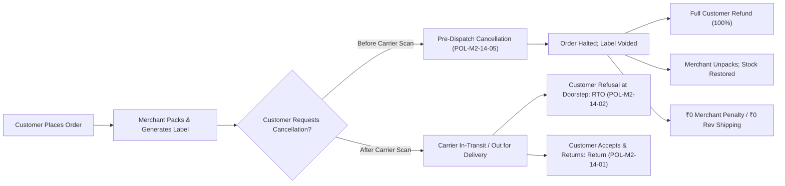

# ATEEVRA Policy: POL-M2-14-05 — Customer-Initiated Cancellation Before Dispatch

**Policy ID:** `POL-M2-14-05`  
**Policy Name:** Customer-Initiated Cancellation Before Dispatch  
**Owner Decision Reference:** OD-02 (Refund Financial Liability) & OD-15 (Cancellation, Return, RTO & Accountability)  
**Parent Blueprint:** [`../ATEEVRA-MARKETPLACE-FINANCIAL-COMMERCIAL-POLICY-BLUEPRINT.md`](../ATEEVRA-MARKETPLACE-FINANCIAL-COMMERCIAL-POLICY-BLUEPRINT.md)  
**Related Policies:** [`POL-M2-14-01-CUSTOMER-RETURNS-AND-REVERSE-SHIPPING.md`](POL-M2-14-01-CUSTOMER-RETURNS-AND-REVERSE-SHIPPING.md), [`POL-M2-14-02-RTO-AND-FAILED-DELIVERY.md`](POL-M2-14-02-RTO-AND-FAILED-DELIVERY.md), [`POL-M2-14-03-MERCHANT-CANCELLATION-PENALTY.md`](POL-M2-14-03-MERCHANT-CANCELLATION-PENALTY.md)  
**Current Governance Status:** `OWNER DIRECTION RECORDED — PROPOSED POLICY REVISION (PENDING OWNER RATIFICATION)`  
**Baseline Policy Version:** `1.1.0-PROPOSED`  
**Effective Date:** Subject to Formal Owner Ratification  
**Audit Date:** 2026-11-04  

---

## 1. Executive Summary & Purpose

In an e-commerce marketplace, customers may decide to cancel an order after payment confirmation but prior to the merchandise being physically handed over to the courier partner. Such cancellations represent consumer discretion exercised within permissible operational boundaries.

Because the merchant has not failed in their contractual obligations and no outward carrier freight movement has occurred, this policy establishes:
1. Complete financial exoneration for the merchant: **Zero merchant penalty (₹0.00)**.
2. Complete logistics exoneration: **Zero reverse-shipping fee (₹0.00)**.
3. Complete facilitation fee waiver: **Zero platform facilitation fee** retained by ATEEVRA.
4. **100% full customer refund** without cancellation deductions.
5. Merchant operational accounting for packaging materials and handling labor (₹39–₹79) as internal sunken operational drag.
6. Zero negative impact on **Merchant Account Health** scoring.

---

## 2. Owner-Approved Policy Directives

> **OWNER POLICY BASELINE — CUSTOMER PRE-DISPATCH CANCELLATION:**
> 
> 1. A customer is permitted to cancel an order at any point prior to physical dispatch handover to the 3PL logistics courier partner.
> 2. **Zero Merchant Penalties:** The merchant shall NOT be charged any penalty, cancellation levy, or operational fee by ATEEVRA for customer-initiated pre-dispatch cancellations.
> 3. **Zero Reverse-Shipping Charges:** Because the goods have not left the merchant's warehouse, no logistics reverse-shipping fee is chargeable to the merchant.
> 4. **100% Customer Refund:** The customer is entitled to an uncompromised 100% refund of the purchase price and any paid shipping fee, returned to the original payment source.
> 5. **Packaging Drag Tracking:** If the merchant had already packed the order prior to cancellation, the packaging consumables and packing labor cost (estimated at ₹39.00 to ₹79.00) are recognized as the merchant's internal operational drag, non-reimbursable by ATEEVRA or the customer.
> 6. **Zero Account Health Penalty:** Customer-initiated cancellations before dispatch do NOT impact the merchant's Order Cancellation Rate (OCR) or account standing.

---

## 3. Pre-Dispatch Operational Milestone & State Machine

The boundary separating a pre-dispatch cancellation from an in-transit return or RTO is defined strictly by the first electronic courier scan:

### 3.1 State Transitions

1. **`CONFIRMED` -> `CANCELLED_BY_CUSTOMER`:**
   - Order cancelled immediately by customer before merchant generates manifest.
   - Zero physical impact; electronic inventory unreserved immediately.
2. **`READY_FOR_PICKUP` -> `CANCELLED_BY_CUSTOMER`:**
   - Merchant has generated the 3PL shipping label and packed the goods, but the carrier has not scanned the parcel.
   - ATEEVRA automatically invokes the courier API to cancel the pickup request and void the tracking AWB.
   - Merchant receives an instant portal webhook and alert to set aside the parcel, unpack it, and return units to active warehouse stock.

---

## 4. Financial, Ledger & Settlement Accounting

### 4.1 Financial Impact Breakdown

For a baseline ₹1,000 order cancelled by the customer prior to dispatch:

| Financial Element | Value (₹) | Payer / Bearer | Accounting Classification |
| :--- | :---: | :---: | :--- |
| **Gross Order Value** | ₹1,000.00 | Customer | Fully refunded |
| **Merchant Entitlement** | ₹0.00 | Merchant | Nullified (no sale completed) |
| **Platform Facilitation Fee** | ₹0.00 | ATEEVRA | ₹0 earned / ₹0 charged |
| **Forward Logistics Cost** | ₹0.00 | Courier | Courier AWB voided at ₹0 charge |
| **Reverse Logistics Cost** | ₹0.00 | — | Not incurred (parcel remains on site) |
| **Merchant Penalty** | ₹0.00 | Merchant | **Zero penalty** |
| **Gateway MDR Loss** | ₹0.00 to ₹18.00 | ATEEVRA | Incurred by platform under OD-02-03 |
| **Packaging & Labor Sunken Drag** | ₹39.00 to ₹79.00 | Merchant | Internal merchant operational expense |

### 4.2 Merchant Packaging & Handling Drag

When an order is cancelled after packaging:
- **Consumable Loss (₹15–₹30):** Box, polybag, tape, bubble wrap, and printed thermal AWB label are generally unrecoverable.
- **Labor Drag (₹24–₹49):** Warehouse picker/packer time spent picking, packing, unboxing, and restocking.
- **Policy Treatment:** As is standard across global marketplace models, this drag is treated as an ordinary cost of conducting retail business and is borne by the merchant. ATEEVRA provides automated tools (immediate SMS/webhook notification) to minimize merchant packaging waste.

### 4.3 Double-Entry Ledger Mechanics

When `CANCELLED_BY_CUSTOMER` occurs prior to carrier pickup:
1. **Customer Refund Ledger:**
   - Debit: `Customer Funds Escrow` (₹1,000.00)
   - Credit: `Payment Gateway Clearing` (₹1,000.00)
2. **Merchant Settlement Ledger:**
   - No entries. The order is archived without any debit or credit to the merchant's account.

---

## 5. Account Health & Merchant Protection

- **OCR Exemption:** Pre-dispatch cancellations initiated by customers are explicitly filtered out of the merchant's Order Cancellation Rate calculation ($\text{OCR}$).
- **Abuse Prevention:** If customer cancellation occurs due to merchant delay (e.g., customer cancels because merchant failed to dispatch within 48 hours), the cancellation reason code is audited. If the cancellation was prompted by merchant unresponsiveness past the SLA cut-off, it is reclassified as `CAN-MRCH-04` under [`POL-M2-14-03`](POL-M2-14-03-MERCHANT-CANCELLATION-PENALTY.md).

---

## 6. Governance & System Boundary Compliance

1. **Strictly Documentation:** No automated state machines or webhook triggers are implemented in code until formal ratification.
2. **Preservation of Pre-existing Policies:** This policy harmonizes with [`POL-M2-14-01`](POL-M2-14-01-CUSTOMER-RETURNS-AND-REVERSE-SHIPPING.md) and [`POL-M2-14-02`](POL-M2-14-02-RTO-AND-FAILED-DELIVERY.md) by defining the unambiguous pre-dispatch cutoff.
3. **Traceability:** Recorded in [`POLICY-REGISTER.md`](../POLICY-REGISTER.md).
