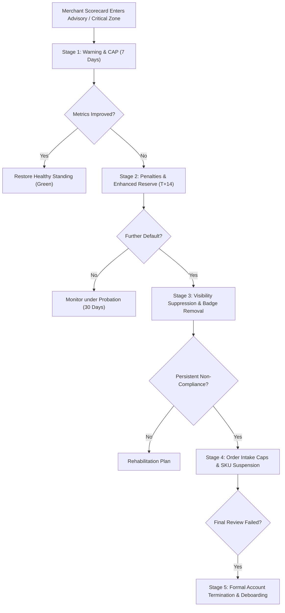

# ATEEVRA Policy: POL-M2-14-06 — Merchant Account Health & Progressive Enforcement Framework

**Policy ID:** `POL-M2-14-06`  
**Policy Name:** Merchant Account Health & Progressive Enforcement Framework  
**Owner Decision Reference:** OD-08 (Merchant Lifecycle & Operational Performance) & OD-15 (Cancellation, Return, RTO & Accountability)  
**Parent Blueprint:** [`../ATEEVRA-MARKETPLACE-FINANCIAL-COMMERCIAL-POLICY-BLUEPRINT.md`](../ATEEVRA-MARKETPLACE-FINANCIAL-COMMERCIAL-POLICY-BLUEPRINT.md)  
**Related Policies:** [`POL-M2-14-01-CUSTOMER-RETURNS-AND-REVERSE-SHIPPING.md`](POL-M2-14-01-CUSTOMER-RETURNS-AND-REVERSE-SHIPPING.md), [`POL-M2-14-02-RTO-AND-FAILED-DELIVERY.md`](POL-M2-14-02-RTO-AND-FAILED-DELIVERY.md), [`POL-M2-14-03-MERCHANT-CANCELLATION-PENALTY.md`](POL-M2-14-03-MERCHANT-CANCELLATION-PENALTY.md), [`POL-M2-14-04-MERCHANT-DISPATCH-SLA-LATE-PENALTY.md`](POL-M2-14-04-MERCHANT-DISPATCH-SLA-LATE-PENALTY.md), [`POL-M2-14-05-CUSTOMER-PRE-DISPATCH-CANCELLATION.md`](POL-M2-14-05-CUSTOMER-PRE-DISPATCH-CANCELLATION.md)  
**Current Governance Status:** `OWNER DIRECTION RECORDED — PROPOSED POLICY REVISION (PENDING OWNER RATIFICATION)`  
**Baseline Policy Version:** `1.1.0-PROPOSED`  
**Effective Date:** Subject to Formal Owner Ratification & Merchant Agreement Addendum Execution  
**Audit Date:** 2026-11-04  

---

## 1. Executive Summary & Purpose

A thriving multi-vendor marketplace requires high fulfillment standards, reliable inventory management, and fair accountability. When individual merchants repeatedly default on delivery SLAs, cancel confirmed orders, or supply defective merchandise, they harm the platform's brand equity, diminish customer retention, and inflict direct financial losses.

This policy establishes ATEEVRA's central **Merchant Account Health & Progressive Enforcement Framework**:
1. An objective, data-driven **Account Health Scoring Matrix** tracking 8 critical operational metrics.
2. A **5-Stage Progressive Enforcement Mechanism** transitioning from operational advisories to financial reserve withholding, catalog visibility suppression, order intake capping, and eventual contract termination.
3. Defined **cure periods, appeal procedures, and natural justice safeguards** ensuring fairness.
4. Comprehensive contractual integration governing set-off, reserve retention, and liquidation of pending balances upon account termination.

---

## 2. Owner-Approved Policy Directives

> **OWNER POLICY BASELINE — ACCOUNT HEALTH & ENFORCEMENT:**
> 
> 1. Every active merchant on ATEEVRA is evaluated against a continuous **Account Health Scorecard** refreshed on a rolling 30-day and 90-day basis.
> 2. Violations of fulfillment standards, dispatch SLAs, cancellation boundaries, and quality benchmarks shall trigger **progressive, tiered enforcement** rather than immediate arbitrary termination.
> 3. The 5 enforcement tiers comprise:
>    - **Stage 1:** Formal Notification & Operational Warning (7-day corrective action plan).
>    - **Stage 2:** Financial Penalties & Enhanced Reserve Withholding (settlement hold extended to T+14, reserve withheld).
>    - **Stage 3:** Account Health Downgrade & Visibility Suppression (badge removal, catalog deprioritization).
>    - **Stage 4:** Temporary Order Restrictions (daily order volume caps, suspension of high-defect SKUs).
>    - **Stage 5:** Formal Account Review for Suspension / Deboarding (termination of merchant agreement).
> 4. Merchants maintain a protected right of appeal with a **5-business-day response window** before Stage 3, 4, or 5 sanctions take effect, except in cases of verified fraud or severe consumer safety hazards.
> 5. Pending liabilities, reverse-shipping fees, and penalties are enforceable via contractual set-off against pending settlement reserves.

---

## 3. Account Health Metrics & Benchmark Matrix

Merchant performance is scored across eight core key performance indicators (KPIs):

| Metric Code | Metric Name | Mathematical Definition | Target (Green) | Advisory (Yellow) | Critical Breach (Red) |
| :--- | :--- | :--- | :---: | :---: | :---: |
| **KPI-01** | **Order Cancellation Rate (OCR)** | $\frac{\text{Merchant Cancellations}}{\text{Total Confirmed Orders}} \times 100$ | $< 1.0\%$ | $1.0\% - 2.5\%$ | $> 2.5\%$ |
| **KPI-02** | **Late Dispatch Rate (LDR)** | $\frac{\text{Late Courier Pickups}}{\text{Total Dispatched Orders}} \times 100$ | $< 2.0\%$ | $2.0\% - 4.0\%$ | $> 4.0\%$ |
| **KPI-03** | **Defect Return Rate (DRR)** | $\frac{\text{Defective / Wrong Item Returns}}{\text{Total Delivered Orders}} \times 100$ | $< 1.5\%$ | $1.5\% - 3.0\%$ | $> 3.0\%$ |
| **KPI-04** | **Merchant-Fault RTO Rate** | $\frac{\text{RTOs due to Incorrect Packaging/Address}}{\text{Total Dispatched Orders}} \times 100$ | $< 0.5\%$ | $0.5\% - 1.5\%$ | $> 1.5\%$ |
| **KPI-05** | **Customer Dispute Rate (CDR)** | $\frac{\text{Escalated Customer Tickets}}{\text{Total Delivered Orders}} \times 100$ | $< 0.5\%$ | $0.5\% - 1.0\%$ | $> 1.0\%$ |
| **KPI-06** | **SLA Handover Adherence** | $\frac{\text{Manifest Handover on Time}}{\text{Total Orders Handed Over}} \times 100$ | $> 98.0\%$ | $95.0\% - 98.0\%$ | $< 95.0\%$ |
| **KPI-07** | **Weight Discrepancy Rate (WDR)** | $\frac{\text{Courier Reweigh Discrepancies}}{\text{Total Weighed Shipments}} \times 100$ | $< 2.0\%$ | $2.0\% - 5.0\%$ | $> 5.0\%$ |
| **KPI-08** | **Policy Breach Incident Count** | Direct counts of IP infringement, prohibited items, or off-platform solicitation | 0 | 1 | $\ge 2$ |

---

## 4. Progressive Enforcement Framework (The 5 Stages)

When a merchant enters the Advisory (Yellow) or Critical Breach (Red) zones across one or more KPIs, enforcement escalates sequentially:

### 4.1 Stage 1: Formal Notification & Operational Warning
- **Trigger:** Any single KPI enters Advisory (Yellow) for two consecutive evaluation cycles (14 days), or a first-time Red breach.
- **Action:**
  - Automated performance notification via Merchant Portal and registered email.
  - Merchant is required to review fulfillment bottlenecks and submit an operational **Corrective Action Plan (CAP)** within 7 calendar days.
- **Commercial Impact:** Zero direct financial penalty or search suppression.

### 4.2 Stage 2: Financial Penalties & Enhanced Reserve Withholding
- **Trigger:** Failure to submit or meet CAP goals within 14 days; or Order Cancellation Rate $> 2.5\%$; or Late Dispatch Rate $> 4.0\%$.
- **Action:**
  - Rigid, non-waivable application of per-order penalties: **₹25.00** per merchant cancellation ([`POL-M2-14-03`](POL-M2-14-03-MERCHANT-CANCELLATION-PENALTY.md)) and **₹50.00** per late dispatch ([`POL-M2-14-04`](POL-M2-14-04-MERCHANT-DISPATCH-SLA-LATE-PENALTY.md)).
  - Settlement payout cycle extended from standard **T+7 to T+14**.
  - Payout reserve withholding increased from standard 5% to **15% of rolling 30-day gross GMV** to cover elevated return and penalty liabilities.

### 4.3 Stage 3: Account Health Downgrade & Visibility Suppression
- **Trigger:** Merchant remains in Critical (Red) standing for $> 21$ consecutive days across two or more operational KPIs.
- **Action:**
  - Immediate removal of "Top Rated", "Verified", or "Prime Seller" badges.
  - Exclusion from algorithmic promotional carousels, category landing banners, and featured search placements.
  - Search ranking down-weighting: product listings demoted in search results by a 30% visibility penalty factor.

### 4.4 Stage 4: Temporary Order Intake Restrictions
- **Trigger:** Sustained Critical breach for $> 30$ days, or Defect Return Rate $> 5.0\%$, or failure to service existing orders.
- **Action:**
  - Immediate suspension of top 20% highest-defect SKUs.
  - Imposition of a **Daily Order Intake Cap** (e.g., maximum 10 orders per day) to allow the merchant's warehouse to clear backlog without disappointing new customers.
  - Mandatory virtual inspection / packaging audit call with ATEEVRA Merchant Operations.

### 4.5 Stage 5: Formal Account Review for Suspension / Deboarding
- **Trigger:** Fraud, counterfeiting, intentional shipment of empty boxes, unresponsiveness $> 45$ days, or total failure of Stage 4 rehabilitation.
- **Action:**
  - Issuance of formal **Notice of Intent to Terminate Merchant Agreement**.
  - Complete suspension of catalog and storefront visibility.
  - Freezing of merchant settlement account.
  - Execution of final contractual set-off:
    $$\text{Final Payout} = \text{Settlement Escrow} - \sum \text{Pending Penalties} - \sum \text{Reverse Logistics Debits} - \text{Warranty/Return Reserve}$$
  - Payout of any remaining surplus withheld for a mandatory **60-day post-termination warranty period** before final electronic wire release.

---

## 5. Due Process, Cure Periods & Appeals Mechanism

To ensure compliance with Indian commercial law and the principles of natural justice:
1. **Notice & Disclosure:** Every penalty or enforcement escalation must provide full transaction-level line items, courier scans, and reason codes in the merchant portal.
2. **Right to Appeal:** The merchant has **5 business days** from receipt of any Stage 2, 3, or 4 escalation to submit an appeal.
3. **Independent Escalation Committee:** Appeals against Stage 4 and Stage 5 actions are reviewed by a three-member panel comprising Operations, Finance, and Legal.
4. **Cure Period:** A merchant entering Stage 2 or Stage 3 is granted a **14-calendar-day cure period** during which returning KPIs to Green standing automatically resets the merchant to Stage 1.

---

## 6. Contractual Integration & Legal Safeguards

1. **Contractual Set-Off:** All financial deductions, reserve withholdings, and liquidated damages under this policy are executed pursuant to the express netting clause of the ATEEVRA Merchant Agreement.
2. **Non-Waiver:** Failure by ATEEVRA to strictly enforce an enforcement stage on a specific occurrence does not constitute a waiver of rights for subsequent breaches.
3. **Traceability:** Recorded in [`POLICY-REGISTER.md`](../POLICY-REGISTER.md) and tracked in [`M2-14-OWNER-DECISION-REGISTER.md`](../../M2-14-OWNER-DECISION-REGISTER.md).
